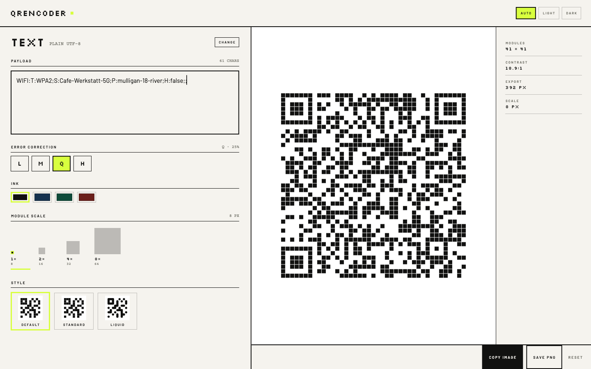

# QREncoder

A local-only QR generator for macOS, Linux and Android. Type or paste, or compose one of
fourteen payloads — Wi-Fi, vCard, BIP 21, EIP-681 and the rest — and the symbol is drawn on the
next frame. There is no Generate button, no network call and no stored payload.

The project page lives at <https://jooray.github.io/qrencoder/>.



## What it does

- **Live redraw.** Every keystroke re-encodes; encoding is synchronous, so there is nothing to
  wait for. The caret is in the payload box the moment the window opens.
- **Fourteen payloads.** Text, URL, Wi-Fi, email, phone, SMS, geo, calendar (iCalendar VEVENT),
  contact (vCard 3.0), Bitcoin (BIP 21), Lightning (BOLT 11), Monero, Zcash (ZIP 321) and
  Ethereum/EVM (EIP-681). Each composes its string from typed fields and shows the result
  underneath.
- **Three symbol styles.** Default (1 px module gap), Standard (plain squares) and Liquid
  (merged blobs with the finder eyes preserved). Preview, style chip and exported PNG come from
  one painting routine.
- **Spec-correct exports.** ISO/IEC 18004 four-module quiet zone, integer module scale, PNG at
  `(modules + 8) × scale` pixels. The symbol is always dark on a white plate; dark mode changes
  the chrome, never the symbol.
- **Theme Auto / Light / Dark**, with the macOS title bar and the Android system bars following
  the choice.
- **Share into it on Android.** Share a link from any app and QREncoder opens with the symbol
  already drawn.
- **Nothing leaves the machine.** No network requests at runtime, no telemetry, no accounts.
  Preferences (error correction, ink, scale, style, theme) are remembered; payload contents
  never are.

## Install

- **macOS** — `QREncoder-<version>.dmg` from the [releases page](https://github.com/jooray/qrencoder/releases),
  or build it yourself (below).
- **Android** — `qrencoder-<version>.apk` from the same page, or update it with
  [Obtainium](https://github.com/ImranR98/Obtainium) pointing at those releases. It is also on
  [Zapstore](https://zapstore.dev/apps/io.bednar.qrencoder).
- **Linux** — build and run from source; there is no packaged build yet.

## Build and run

Requires Flutter 3.47 or newer.

```sh
flutter pub get
flutter run -d macos
flutter build macos --release

flutter run -d <android-device>
flutter build apk --release
```

The macOS window opens at 1440 × 900. A payload can also arrive on the command line:

```sh
qrencoder "WIFI:T:WPA2;S:Cafe;P:secret;;"
```

Android release builds are signed with the publisher key at
`~/.apk-signing-keystore/signing.properties`; without that file Gradle falls back to the debug
key so a plain checkout still builds.

## Tests

```sh
flutter test                 # payload composition, widget behaviour, screenshots
flutter test --update-goldens test/goldens_test.dart
```

Screenshots in `docs/img/` are rendered by the golden tests, so the site can be regenerated
from the same code it documents.

## About this build

QREncoder 1.1.0 was built by an agent running on **free tokens** — DeepSeek 4.1 Flash on its free
tier — with nothing paid anywhere in the loop. It is not a demo or a benchmark artefact: it is
the QR generator its author uses, standing in for a Mac app that is no longer maintained.

The app, the site and the release came out of that session working from a written spec
(`SPEC.md`) and a design brief (`DESIGN.md`). The experiment, its numbers, and the rougher first
build from a pool of free models are written up in:

- [Token poverty: can you use freely available AI to do productive work?](https://juraj.bednar.io/en/blog-en/2026/10/31/token-poverty-can-you-use-freely-available-ai-to-do-productive-work/) (English)
- [Tokenová chudoba: dá sa s voľne dostupnou AI robiť produktívna práca?](https://juraj.bednar.io/blog/2026/10/31/tokenova-chudoba-da-sa-s-volne-dostupnou-ai-robit-produktivna-praca/) (Slovak)
